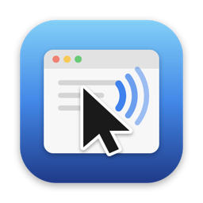
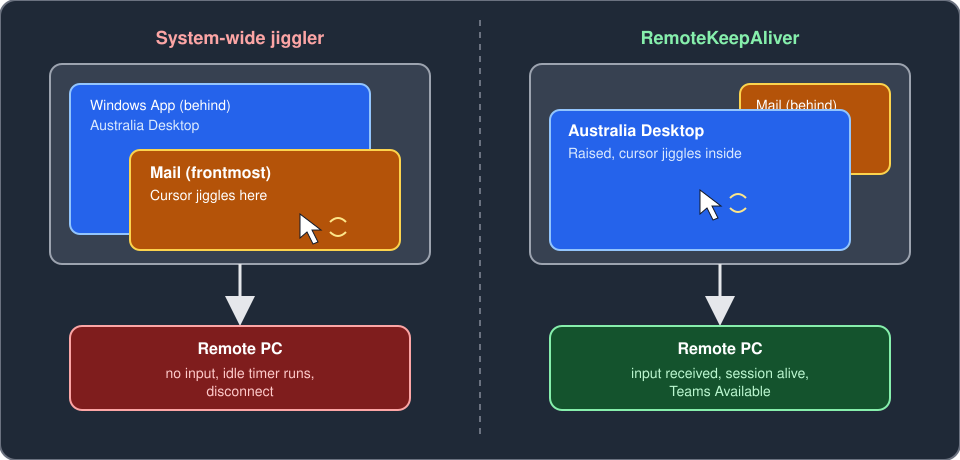
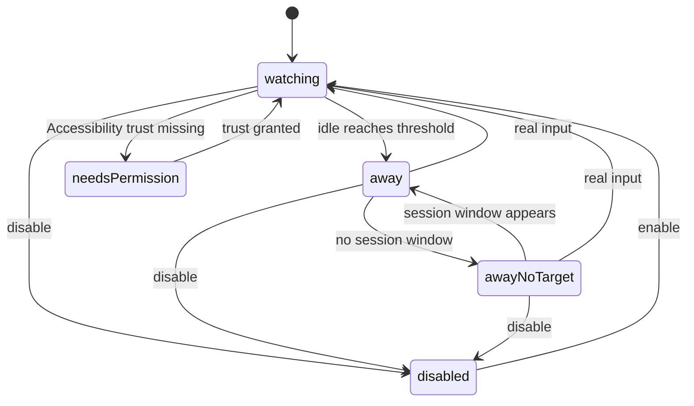
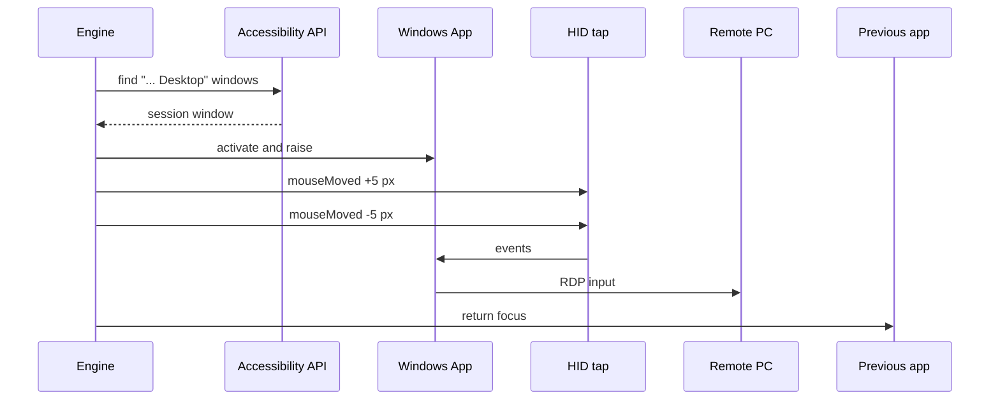
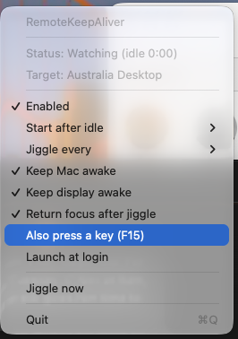

# RemoteKeepAliver



RemoteKeepAliver is a small macOS menu bar app that keeps a Windows App (Microsoft Remote Desktop) session alive. After you go idle, it raises the remote session window, moves the mouse a few pixels inside it, and hands focus back to whatever you were using. A system-wide mouse jiggler is not enough because Windows App only forwards input to the remote PC when the pointer and focus are in the session window. Jiggling over Mail never reaches the remote machine, so its idle timer keeps running.

## The problem and the fix



### Engine states



### One away-mode pulse



## Menu



Screenshot of the menu while watching, with an open session named Australia Desktop as the target.

## Requirements

- macOS 14 or later.
- Windows App (bundle id `com.microsoft.rdc.macos`) with an open remote session.
- Accessibility permission, needed to read window titles, raise the session window and post mouse events.
- Screen Recording permission is not needed. Window titles come from the Accessibility API, not from `CGWindowListCopyWindowInfo`.

## Install

```sh
git clone https://github.com/Ryanjlowe/macos-windowsapp-remotekeepaliver.git
cd macos-windowsapp-remotekeepaliver
make bundle     # builds build/RemoteKeepAliver.app, signed with your Apple Development identity if one exists (set `SIGN_IDENTITY` to override), otherwise ad-hoc. Ad-hoc builds lose the Accessibility grant on every rebuild
make install    # copies it to /Applications
```

On first launch the app asks for Accessibility access. Grant it in System Settings, Privacy & Security, Accessibility, then quit and relaunch the app. macOS only applies the grant to a process started after it. Run it from `/Applications` so the grant keeps matching the same app.

## Usage

Click the menu bar icon. The menu shows the current status and target window, then the settings:

- Enabled: master switch.
- Start after idle: 1, 2 (default), 5 or 10 minutes of no keyboard or mouse input.
- Jiggle every: 30 seconds, 1 minute (default), 2 or 4 minutes.
- Keep Mac awake (default on) and Keep display awake: hold sleep assertions while enabled, because a sleeping or locked Mac cannot feed the session.
- Return focus after jiggle (default on).
- Also press a key (F15): optional extra input that Windows ignores.
- Launch at login.
- Jiggle now: one manual pulse in any state, useful to test that input reaches the remote.

## How it decides you are away

The app polls the system idle counter every few seconds. When idle passes the threshold it enters away mode and, once per jiggle interval, pulses the session window. It targets windows titled like `<Name> Desktop` and never the Connection Center window titled `Windows App`. The app's own synthetic mouse events reset the system idle counter, so the engine records the time window of each of its bursts and ignores any input that falls inside it. Only input outside those windows counts as you returning, which stops jiggling immediately. See [docs/DESIGN.md](docs/DESIGN.md) for the full behavior.

## Diagnostics

Run the bundle binary directly:

```sh
build/RemoteKeepAliver.app/Contents/MacOS/RemoteKeepAliver --list-windows   # show Windows App windows and the selected target
build/RemoteKeepAliver.app/Contents/MacOS/RemoteKeepAliver --jiggle-once    # run one pulse and exit
build/RemoteKeepAliver.app/Contents/MacOS/RemoteKeepAliver --idle           # print measured idle for 15 seconds
log stream --predicate 'subsystem == "com.ryanlowe.RemoteKeepAliver"' --level info
```

## If it still disconnects

Not every disconnect is an idle timeout. See [docs/RESEARCH.md](docs/RESEARCH.md) for the sources.

- Read the disconnect dialog text. It distinguishes idle timeout, lock, gateway and network causes.
- On the remote PC, open the Event Viewer log `Microsoft-Windows-TerminalServices-LocalSessionManager/Operational` and read the reason in the disconnect event text.
- A gateway or VPN may have its own idle timeout that real input inside the session does not reset.
- If the Mac sleeps or the screen locks, the session drops or input never arrives. Keep Mac awake covers sleep.
- Teams discriminator: if Teams on the remote PC stays Available until each drop, input is arriving and the cause is probably elsewhere. Treat Teams presence as a hint, not proof.
- A forced or manual remote lock with disconnect-on-lock cannot be prevented by input.

Policy caveat: idle limits are often a security control. Use this app only where your organization allows it.

## Development

```sh
swift build
swift test
swift test --filter KeepAliveCoreTests.SessionWindowSelectorTests/testName
```

Layout:

- `Sources/KeepAliveCore`: all logic (engine, window selection, Accessibility, input, sleep assertions).
- `Sources/RemoteKeepAliver`: thin AppKit shell (`main.swift`, status menu).
- `Tests/KeepAliveCoreTests`: XCTest suites with fakes for every system dependency.
- `Packaging` and `Makefile`: Info.plist and bundle assembly.

Docs: [DESIGN.md](docs/DESIGN.md), [RESEARCH.md](docs/RESEARCH.md), [scout-findings.md](docs/scout-findings.md).

## License

MIT. See [LICENSE](LICENSE).
